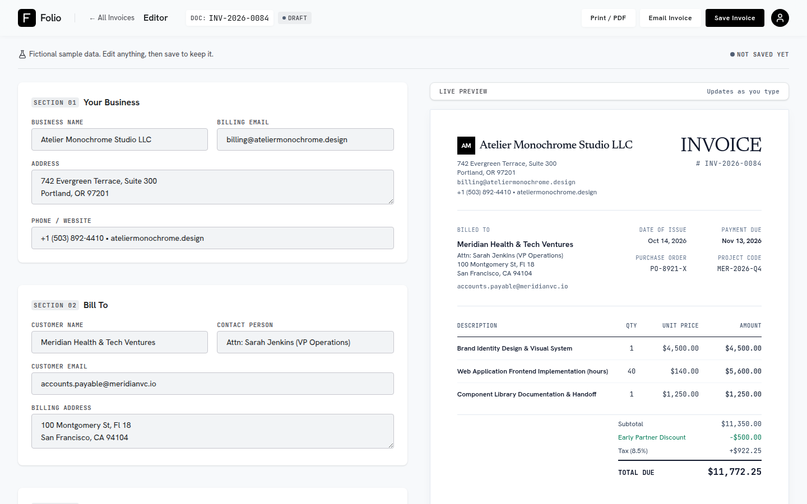
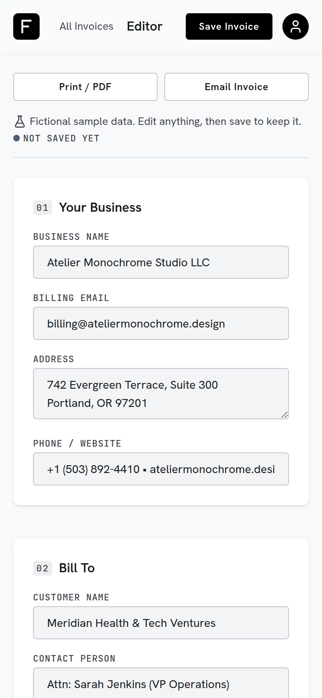
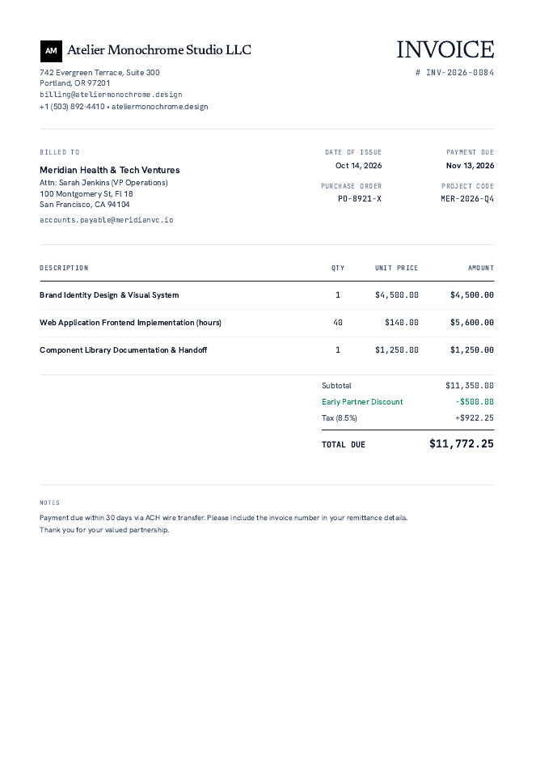

# Folio — Invoice Generator

A browser-based invoice editor for a small business: edit an invoice, watch a live
"paper" preview update, save it, reload it later, email it, and print / save it as a PDF.
Built as a time-boxed (3 hour) full-stack exercise. All business and customer data in the
app is **fictional sample data**.

| Editor (desktop) | Editor (mobile) | Print / Save as PDF output |
| --- | --- | --- |
|  |  |  |

## What works

| Feature | Status |
| --- | --- |
| Business + customer details, invoice number, issue / due date, notes | Working |
| Add / edit / remove line items (stable IDs, so rows don't jump) | Working |
| Live preview that updates as you type | Working |
| USD maths: round each line to cents → sum → discount → tax → total | Working, unit-tested (`2 × $50 − $10 + 10% = $99.00`) |
| Validation: no negative qty / price / discount / tax, discount ≤ subtotal | Working client-side **and** re-checked on the server |
| Custom fields: add, edit, hide / show, remove; never affect totals | Working; hidden fields are absent from preview, print and email |
| Save invoices and open them again (list at `/invoices`) | Working; verified across a page reload **and** a server restart |
| Print / Save as PDF (only the invoice is printed) | Working; verified by rendering a real PDF |
| Email an invoice over SMTP | Working: a real test email sent through **Brevo** SMTP was received at a Gmail address; also covered by tests against a local SMTP server |
| Responsive (desktop + mobile), keyboard access, visible focus | Working; axe-core audit clean on the main screens |

## Tech stack

- **Next.js 16** (App Router) + **React 19** + **TypeScript**, **Tailwind CSS v4**
- Design from **Google Stitch** ("Ledger & Press": Newsreader / Hanken Grotesk / JetBrains Mono, loaded with `next/font`)
- **nodemailer** for SMTP, **lucide-react** for icons
- **Vitest** for unit tests (dev), `smtp-server` + `mailparser` (dev) for the SMTP tests and a local mail catcher
- Storage: a JSON file on disk (no database service)

## Prerequisites

- Node.js 20.9 or newer (developed and tested on Node 22) and npm

## Install and run

```bash
npm install
cp .env.example .env.local     # optional for saving; needed only for email (see below)
npm run dev                    # http://localhost:3000
```

Other commands:

```bash
npm test          # unit tests (calculations, validation, storage, email, SMTP)
npm run lint
npm run build && npm start     # production build
npm run smtp-sink # local mail catcher for testing email without any provider account
```

## Backend and storage

- API routes (Next.js Route Handlers):
  - `GET /api/invoices`, `POST /api/invoices`
  - `GET /api/invoices/:id`, `PUT /api/invoices/:id`
  - `POST /api/email`
- Invoices are stored in **`data/invoices.json`** (gitignored; override the folder with `INVOICE_DATA_DIR`).
  Format: `{ "version": 1, "invoices": { "<uuid>": { id, createdAt, updatedAt, invoice } } }`.
- The invoice is stored exactly as edited: numbers stay as the strings typed (no precision loss) and
  dates stay as `yyyy-mm-dd`. Custom fields are stored with their `visible` flag.
- Every request body is validated on the server (`lib/validate-invoice.ts`), including the money rules.
  Server errors return a generic message; details are logged server-side only.
- Writes go through an in-process queue and an atomic write-then-rename, and a corrupt file is never
  silently overwritten.
- A saved invoice has a stable link: `/?id=<uuid>`.

## Email setup (SMTP)

Email is sent over standard SMTP and was tested with **Brevo**. Other SMTP providers should work with their
own host and credentials, but only Brevo was tried. Copy `.env.example` to `.env.local` and fill in the values. **Never commit `.env.local`.**

```env
# Brevo (tested)
SMTP_HOST=smtp-relay.brevo.com
SMTP_PORT=587
SMTP_USER=<SMTP login from Brevo: SMTP & API → SMTP>
SMTP_PASS=<SMTP key generated there (not your account password)>
EMAIL_FROM="Folio Invoices <sender-you-verified@yourdomain.example>"
# EMAIL_ALLOWED_RECIPIENTS=you@yourdomain.example  # optional safety rail (see below)
```

- The sender in `EMAIL_FROM` must be verified in Brevo (*Senders, Domains & Dedicated IPs → Senders*). The
  recipient does not need to be verified. A free-mail sender (e.g. Gmail) can land in spam; a domain you own is better.
- `EMAIL_ALLOWED_RECIPIENTS` is **optional**. When unset, any recipient can be emailed, so whoever runs
  the app can test it with their own address. When set (comma-separated addresses or `@domain` entries) the
  server refuses everyone else. Use it whenever the app is reachable by people you don't trust.
- All credentials stay on the server; nothing SMTP-related is in the client bundle (checked by
  searching the build output).
- If SMTP isn't configured, **Email Invoice** shows a clear "Email isn't configured" message rather than
  pretending to send.
- The success message says the mail server *accepted the invoice for delivery*. That is all SMTP can
  confirm; it does not claim inbox delivery.

**Test email without a provider:**

```bash
npm run smtp-sink     # terminal 1: prints received messages, never delivers anything
# .env.local: SMTP_HOST=127.0.0.1  SMTP_PORT=1025  EMAIL_FROM=invoices@localhost.test
npm run dev           # terminal 2, then use Email Invoice in the app
```

## Key design and implementation decisions

- **One source of truth.** A single `invoice` object lives in `InvoiceWorkspace`; the editor writes to
  it and the preview reads from it, so they cannot drift apart. Plain React state — no state library.
- **Money is integer cents, computed exactly.** Input is parsed into BigInt-scaled decimals and rounded
  once, half-up, in `lib/money.ts` / `lib/calculations.ts`. No floating-point money. Blank input counts as
  0 (nothing flashes while typing); invalid input is reported per field and contributes 0 to totals.
- **Numbers are held as strings in the form** so typing never jumps or shows `NaN`.
- **One display model for preview, print and email.** `lib/invoice-view.ts` formats the invoice once and
  both the on-screen sheet and the email are built from it. The print stylesheet simply hides everything
  except the sheet (`print:hidden`), so what you see is what prints.
- **Server is the trust boundary.** The client validates for UX; the API re-validates everything.
- **Storage kept deliberately small.** A JSON file behind one module (`lib/server/invoice-store.ts`) needs no
  account or secrets and runs after a plain clone. It is easy to swap for a database.
- **Next.js 16 `cacheComponents`** is on in this scaffold, so request-time reads (search params, the
  invoice file) happen inside `<Suspense>` and the page shell is prerendered.
- **Design fidelity vs. honesty.** I followed the Stitch layout and tokens but removed elements that were
  fake or outside the brief (e.g. "auto-saved 2 mins ago", Version History, Templates, multi-currency).

## Tests and verification performed

- `npm test`: **66 unit tests**: calculation rules and edge cases (the required example, empty invoice,
  zero discount/tax, discount equal to / over subtotal, negatives, cent rounding, per-line rounding),
  server-side validation, the storage module (incl. concurrent writes and corrupt file), email content
  (HTML escaping, header-injection), and real SMTP conversations against an in-process SMTP server.
- Browser tests (Playwright driving Chrome, run during development; scripts are not in the repo):
  editor flows, save → reload → server restart → reload, failed-save paths, email dialog states, print
  emulation + a rendered PDF (one A4 page, no editor UI, hidden fields absent), mobile overflow.
- **axe-core** audit: 0 violations on the editor (with and without validation errors), the email dialog and
  the invoice list at desktop and 390px widths. Keyboard-only add-item / toggle / dialog flows checked.
- `npm run lint` and `npm run build` pass without warnings.

## AI tools used

- **Claude Code** (Claude Sonnet 5.5) wrote most of the implementation, tests and this README under my
  direction, one milestone at a time with review gates.
- **Google Stitch** produced the visual design; I supplied its output and the code integrates it.

## Time spent

About 3 hours in total across the milestones (scaffold, Stitch integration, editor + calculations, save /
retrieve, email + print, QA + docs).

## Known limitations and unfinished work

- **Email:** verified with one real send through Brevo to a Gmail address (sent from a Gmail sender, so
  deliverability to other providers may vary). How the HTML renders in other mail clients was not checked.
  Anyone testing needs their own SMTP credentials in `.env.local` (or use `npm run smtp-sink`).
- **Storage needs a writable disk.** The JSON file won't persist on serverless hosts (e.g. Vercel); swap
  `lib/server/invoice-store.ts` for a database there. There is no delete / duplicate invoice.
- **No authentication** (out of scope): everyone using a running instance shares the same invoices.
  `/api/email` also has no rate limiting, so on a public deployment keep `EMAIL_ALLOWED_RECIPIENTS` set.
- **Print** relies on the browser's print dialog; very long invoices will paginate but I only verified the
  one-page case. The preview stacks under the editor below 1280px wide.
- **Number input:** `1,200` (thousands separators) is rejected; quantity / price / rate allow up to 4
  decimals and the discount 2.
- The email contains an HTML/text summary, not a PDF attachment.
